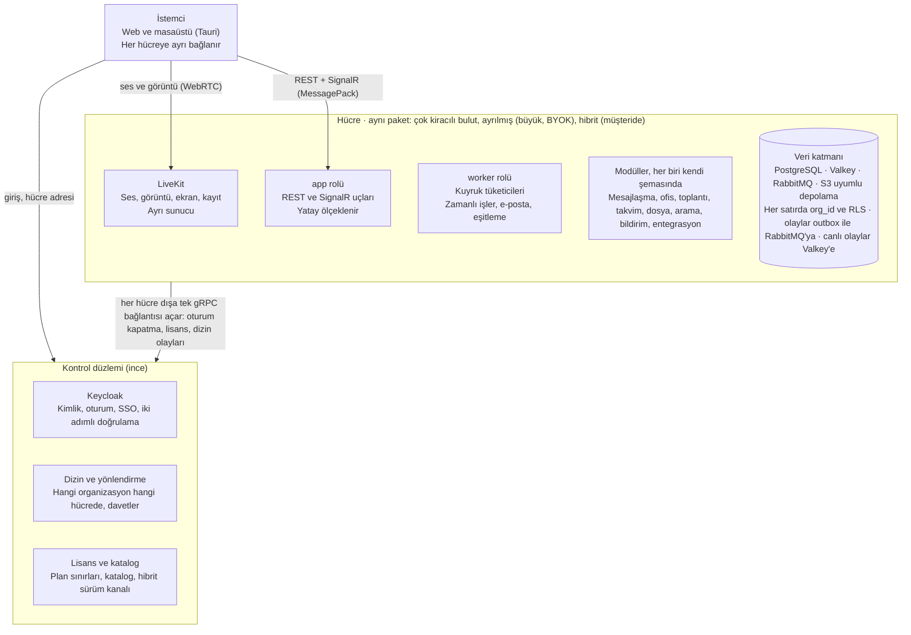

# Sanal Ofis Uygulaması: Gereksinimler ve Modül Planı

> Bu dosya gereksinim dokümanının 25 Ekim 2026 tarihli anlık kopyasıdır. Asıl kaynak Claude Docs'taki dokümandır: https://claude.ai/artifact/6BPW2Ei7EHJZcTUd3ExLKX. İkisi çelişirse asıl doküman geçerlidir; doküman değişince bu kopya yeniden üretilir. Repo ileride herkese açılabileceği için bu kopyada başka ürünlerin marka adları ve fiyat karşılaştırması yer almaz; yeniden üretirken de çıkarılır.

## Amaç ve kapsam

Ürün; ekip mesajlaşmasını, sanal ofisi ve sesli ve görüntülü odaları tek uygulamada birleştiren, gizlilik öncelikli bir ekip çalışma uygulamasıdır. İlk sürüm web ve masaüstünde çıkar; mobil sonraki sürümdedir.

- **Hedef kullanıcı:** Uzaktan ve hibrit çalışan ekipler. Bir kişi birden fazla organizasyona üye olabilir.
- **Pazar:** Dünya geneli. İlk diller Türkçe ve İngilizce. En az yaş 16.
- **Ölçek hedefi:** İlk aşamada 5.000'den fazla eşzamanlı kullanıcı, uzun vadede 100.000. Eşzamanlı kullanıcıların yaklaşık %20'si toplantıda.
- **Geliştirme:** Tek geliştirici ve yapay zekâ alt ajanları. Deploy ve sunucu harcaması en sona bırakıldı.

**İlk sürümün kapsamı:**

- Hesap, çoklu organizasyon, davetler, cihaz ve oturum yönetimi
- Roller ve ayrıntılı izinler, moderasyon, denetim kaydı
- Kanallar, DM'ler, grup DM'ler ve zengin mesajlaşma
- Varlık, durum, çalışma saatleri ve bildirimler
- Dosyalar, arama ve komut paleti
- Sanal ofis: katlar, odalar, kişisel oda, resepsiyon, oyun odası
- Toplantılar: görüntü, ses, ekran paylaşımı, kayıt, misafirler
- Takvim, oda rezervasyonu, tekrarlı toplantılar, Google ve Outlook eşitlemesi
- Entegrasyon altyapısı (Bitbucket, GitHub, GitLab) ve aktiviteler (ilk oyun: çizip tahmin et)
- Kurumsal: OIDC ve SAML ile SSO, BYOK, kendi servisini bağla, hibrit kurulum
- Yapay zekâya hazır altyapı (özellik yok, altyapı var)

**Sonraki sürümlere kalanlar:** Mobil uygulama, yapay zekâ özellikleri, rozetler, Jira entegrasyonu, üçüncü taraf aktiviteler, SCIM, kurumun yönettiği hesaplar, tam kurum içi kurulum, otomatik koltuk atama, botlar, kısa video mesaj, toplantıda beyaz tahta, iş akışları, yazılı standup, ofis duyurusu, yasal saklama modülü.

**Bilinçli olarak yapılmayanlar:** Kişi bazlı verimlilik ölçümü ve sıralama, sohbette susturma, uçtan uca şifreleme, herkese açık organizasyon, organizasyonlar arası ortak kanal, bekleme odası.

## Temel ilkeler

Altı ilke, aşağıdaki bütün kararların gerekçesidir. Yeni bir özellik bunlardan biriyle çelişirse önce ilke tartışılır.

1. **Gizlilik önce:** Yönetici yetkisi mesaj okuma yetkisi vermez. Özel kanallar, DM'ler ve kişisel oda konuşmaları hiçbir rol tarafından görülemez.
2. **Baskı yaratmama:** Kişi bazlı verimlilik ölçümü, sıralama ve seri sayacı yoktur. Oyun puanları saklanmaz, rozetler sessiz ve gizlidir, yöneticiye raporlanmaz.
3. **Şeffaflık:** Kişi, kimlerin neyini görebildiğini görür. Kayıt ve yapay zekâ notu başlayınca herkese bildirilir, takvim görüntülemeleri denetim kaydına yazılır.
4. **Akıcılık:** Kullanıcı hiçbir yerde takılma hissetmemeli. Her etkileşim anında tepki verir; performans bütçesi aşılan iş bitmiş sayılmaz.
5. **Sağlayıcı bağımsızlığı:** Her dış servis kendi arayüzümüzün arkasındadır ve organizasyon bazında değiştirilebilir. Az kullanılan ya da ticari lisansa geçen kütüphanelerden kaçınılır.
6. **Taşınabilirlik:** Aynı paket bizim bulutumuzda da müşterinin sunucusunda da çalışır. Hiçbir karar tek bir bulut sağlayıcısına bağlanmaz.

## Özellik gereksinimleri

Bu bölüm, soru-cevap sürecinde ve arayüz taslağında alınan ürün kararlarının tamamıdır. Ekran karşılıkları "Uygulama Arayüz Taslağı" tuvalindedir.

### Hesap, kimlik ve cihazlar

- Tek hesapla birden fazla organizasyona üye olunur. Hesap kişiye aittir; bir organizasyonun SSO'su hesabın tamamını yönetmez.
- Kayıt e-posta doğrulaması ve Turnstile ile yapılır. Google ile giriş vardır; Apple ile giriş, ücretli Apple Developer hesabı alınınca eklenir.
- İki adımlı doğrulama: doğrulayıcı uygulama ve yedek kodlar.
- Kurumsal SSO organizasyon başınadır: OIDC ve SAML. SSO kullanan organizasyona girişte ayrıca o organizasyonun kimlik sistemiyle doğrulanılır. Kimlik sağlayıcıdan kaldırılan kişi yalnızca o organizasyonda deaktif olur.
- Cihazlar ve oturumlar: platform, yaklaşık konum ve son etkinlik görünür. Tek oturumdan ya da hepsinden çıkılabilir; çıkışta o cihazın canlı bağlantısı anında kesilir.
- Yeni bir cihazdan girişte e-posta uyarısı gider.
- Profil tüm organizasyonlarda ortaktır: ad, soyad, fotoğraf, dil, saat dilimi, tema. Unvan, kat, koltuk ve roller organizasyona özeldir.
- Kişiler "Ad Soyad" olarak görünür; arkada benzersiz gizli bir kimlik ve e-posta vardır.
- Fotoğraf yoksa ad soyadın baş harfleri gösterilir. Renk kişinin kimliğinden türetilir, her yerde aynıdır; Türkçe büyük harf kuralları uygulanır.
- Saat dilimi varsayılan olarak sistemden alınır, elle değiştirilebilir. Başkalarının yerel saati profil kartında ve DM başlığında görünür.
- "Verilerimi indir" ile kişi kendi verisini indirir.
- Hesap silme 30 gün bekler, sonra hesap anonimleştirilir. Mesajlar "Silinmiş kullanıcı" adıyla kalır.

### Organizasyonlar, üyelik ve davetler

- Herkese açık organizasyon yoktur; katılım yalnızca davetle olur.
- Davet bağlantısı: süreli ve kullanım sayısı sınırlıdır; aktif bağlantılar listelenir ve iptal edilebilir.
- E-posta daveti: tek kullanımlıktır ve yalnızca o e-postayla açılan hesapta geçerlidir. Davette rol seçilir.
- Organizasyon değiştirici diğer organizasyonların okunmamış sayılarını gösterir.
- Her organizasyonun tek bir sahibi vardır; sahiplik devredilebilir.
- Plan ve kota kuralları "Planlar ve fiyatlar" bölümündedir; kota yalnızca Ücretsiz plandadır. Ödeme başlangıçta elle alınır.

### Roller, izinler ve moderasyon

- Sistem rolleri: Sahip (tüm izinler, kilitli), Yönetici ve Üye (izinleri düzenlenebilir). Bunlara ek olarak özel roller oluşturulabilir.
- 40'tan fazla ayrıntılı izin vardır; liste ekte.
- "Üye takvimlerini görüntüle" izni bir kapsamla verilir: belirli katlar ya da gruplar.
- Kullanıcı grupları üç işe yarar: kat erişimi, takvim görüntüleme kapsamı ve grup bahsetme.
- Üyeyi çıkar: kişi organizasyondan çıkar, yeni bir davetle dönebilir.
- Üyeyi deaktif et: açık oturumları hemen kapanır, davetle dönemez, mesajları "deaktif" etiketiyle kalır, kişisel odası boşalır. Bir yönetici istediğinde yeniden aktif eder.
- Sohbette susturma yoktur. Toplantıda başkasının mikrofonunu kapatmak ise vardır (Toplantılar bölümü).
- Mesajı bildir: mesajı gören kişi bildirir, kopyası moderasyon yetkisi olanlara gider ve denetim kaydına yazılır.
- Denetim kaydı: rol, izin ve üye değişiklikleri; kanal ve oda işlemleri; takvim görüntülemeleri; giriş ve güvenlik olayları. Özel kanalların adı burada da görünmez.

### Kanallar, DM'ler ve kenar çubuğu

- Herkes kanal açabilir. Kanal açık ya da özel olur; özel kanal kilit simgesiyle gösterilir.
- Özel kanalı yalnızca üyeleri görür ve her üye kişi ekleyebilir.
- Özel kanalı açan kişi kanal sahibidir: üye çıkarır, adını değiştirir, arşivler. Sahiplik devredilebilir; sahip ayrılınca en eski üyeye geçer.
- Yöneticiler özel kanalın adını ve içeriğini göremez; yalnızca var olduğunu ve üye sayısını görür.
- Grup DM'nin adı yoktur, katılımcı adlarıyla görünür. En fazla 9 kişidir ve gruptan ayrılınabilir.
- Grup DM'ye kişi eklenince yeni bir grup açılır; eski mesajlar görünmez. Ad ya da daha fazla kişi gerekirse "Özel kanala dönüştür" kullanılır.
- Kenar çubuğunun üstünde Odalar, Takvim, Thread'ler ve Kaydedilenler durur. Toplantıdayken "Toplantı 1 · Buradasın" satırı eklenir.
- Bölümler daraltılabilir; kişi kendi bölümlerini oluşturur ve konuşmaları sürükleyerek taşır. Bölümler kişiye özeldir.
- DM bölümünde varsayılan olarak son 5 konuşma görünür, gerisi "Tüm DM'ler" ekranındadır. Göster, sırala ve en fazla sayı bölüm ayarından değişir.
- Okunmamış ve yıldızlı konuşmalar her zaman görünür; sessize alınanlar soluk görünür ve sona düşer.
- Tüm DM'ler ekranı: arama ve Tümü, Okunmamış, Gruplar, Kişiler, Yıldızlı, Sessizde filtreleri. Satır üzerinde yıldızla, okundu say, sessize al, gizle.

### Mesajlaşma

- Zengin metin: kalın, italik, üstü çizili, bağlantı, madde ve numaralı liste, alıntı, satır içi kod, kod bloğu, bahsetme.
- Saklama modeli: kaçışlı metin ve yapılandırılmış blok verisi birlikte tutulur. Düz metin bunlardan türetilir, bahsetmeler ayrı bir tabloda tutulur.
- Yazma alanı: "Aa" ile açılan biçim çubuğu; "+" menüsünde dosya yükle (en fazla 100 MB), anket oluştur, toplantı planla; emoji, bahsetme ve ek düğmeleri.
- Enter gönderir, Shift+Enter yeni satır açar. Alan boşken gönder düğmesi pasiftir. Thread yanıt alanı daha küçüktür ve biçim çubuğu kapalı gelir.
- Düzenleme ve silme süresizdir: "düzenlendi" ve "Bu mesaj silindi" gösterilir.
- Okundu bilgisi DM'de kişi bazında, kanalda sayı olarak görünür.
- Tepkiler, sabitleme, kaydetme, bağlantı önizlemesi ve yazıyor göstergesi vardır.
- Thread yan panelde açılır, yalnızca tıklayınca. Yanıt yazarken "Kanala da gönder" seçilebilir.
- Yanıtlama (alıntılı): yanıtlanan kişiye bildirim gider. Orijinal silinirse alıntı "Bu mesaj silindi" olur.
- İletme yalnızca aynı organizasyon içindedir. Kişinin orijinale erişimi varsa "Orijinal mesaja git" görünür.
- Özel kanaldan iletilebilir, ama bağlantı gösterilmez ve kanal adı "Özel kanal" olarak yazılır.
- Orijinal düzenlenirse ya da silinirse kopyalara yansır: "İletilen mesaj, sahibi tarafından silindi". Toplantı sohbetinden iletme yoktur.
- Okundu ve okunmadı işaretleme: kanal için Esc, tümü için Shift+Esc, mesaj için Alt+tık. "Yeni" çizgisi ve "2 yeni mesaj · Okundu say · İlk okunmamışa git" şeridi vardır.
- İşaretleme yalnızca kişinin kendi görünümünü etkiler, "Görüldü" bilgisini geri almaz ve cihazlar arasında eşitlenir.
- Anket: tek ya da çoklu seçim, en fazla 10 seçenek, sonuç görünürlüğü, bitiş zamanı. Anket açıkken oy değiştirilebilir; oluşturan erken kapatabilir; oy verildikten sonra seçenekler düzenlenemez.
- Anonim ankette kimin neye oy verdiğini oluşturan ve yöneticiler dahil kimse göremez. Anket kapanınca bu eşleşme silinir, yalnızca sayılar kalır.
- Mesai dışı uyarısı: alıcı mesai saatleri dışındaysa (girilmemişse 22:00–07:00) yerel saatiyle uyarı çıkar ve "mesai başlangıcında gönder" önerilir.
- Zamanlanmış mesaj: gönderilene kadar düzenlenir, hemen gönderilir ya da silinir. Gönderilince normal mesaj gibi görünür.
- Hatırlatıcı: 20 dakika, 1 saat, yarın 09:00, gelecek hafta ya da özel zaman. Hatırlatıcılar Kaydedilenler altında durur.
- Grup bahsetme ("@tasarım-ekibi"): gruptaki herkese bildirim gider; kanalda olmayanlar için "kanala ekle?" sorulur.
- Mesaj geçmişi sınırsızdır.

### Varlık, durum ve çalışma saatleri

- Durum dört katmandan oluşur. **Varlık** otomatiktir: çevrimiçi, boşta (10 dakika hareketsizlik), çevrimdışı. **Rahatsız etme** açılıp kapanır: 30 dakika, 1 saat, yarına kadar ya da özel süre.
- **Etkinlik** otomatik bir etikettir: Toplantıda, Ekran paylaşıyor. **Müsaitlik:** Mesai dışı, İzinde. Bunlara ek olarak emoji, metin ve süreli **özel durum** vardır.
- Rahatsız etmede bildirim gelmez. Kapı çalınabilir ama sessizdir; giriş sesleri çalmaz.
- "Toplantıda" bir bilgi etiketidir: bildirimler gelir, sesleri toplantı boyunca kapalıdır. Ekran paylaşırken otomatik rahatsız etme bir ayardır.
- Çalışma saatleri: günler, saat aralığı ve saat dilimi. Mesai dışında bildirimler sessize alınır ve kişi başkalarına "mesai dışında" görünür.
- İzin: tarih aralığı ve isteğe bağlı not. DM başlığında "İzinde · 28 Eki'ye kadar" etiketi ve not görünür; bildirimler istenirse tamamen kapatılır.
- Canlı durum tüm organizasyonlarda aynı görünür. Durum geçmişi ise yalnızca o sırada açık olan organizasyona yazılır.
- Durum geçmişi takvimde şerit olarak görünür. Günlük toplamları ve oyun odası süresini yalnızca kişinin kendisi görür.
- Takvim izni olan yönetici şeridi ve platformu (web, masaüstü, mobil) görür, cihaz ayrıntısını görmez.
- Geçmiş varsayılan 12 ay saklanır. Organizasyon süreyi değiştirebilir ya da kaydı tamamen kapatabilir.

### Bildirimler

- Tarayıcı ve masaüstü bildirimleri vardır. Masaüstü uygulaması kapatılınca sistem tepsisinde çalışmaya devam eder. Mobil bildirimler sonraki sürümdedir.
- Konuşma bazında: tüm mesajlar, bahsedilmeler ve yanıtlar, hiçbiri. Ek ayarlar: takip edilen thread yanıtları, @kanal ve @burada'yı yok sayma, ses.
- Sessize alma: 1 saat, 8 saat, yarına kadar, ben açana kadar. Organizasyon da toptan sessize alınabilir.
- Öncelik sırası: rahatsız etme, izin ve mesai dışı önce gelir; sonra konuşma ayarı, sonra organizasyonu sessize alma, en son hesap varsayılanı.
- Bildirim zili: Tümü, Bahsedilmeler, Toplantılar ve Odalar sekmeleri. Rahatsız etme açıkken bildirimler burada birikir.

### Dosyalar, arama ve komut paleti

- Yükleme başına sınır herkes için 100 MB'dır; depolama kotası yalnızca Ücretsiz plandadır (dosya ve kayıt için toplam 5 GB). İstemci dosyayı imzalı bir adresle doğrudan depolamaya yükler.
- Kanalın Dosyalar, Bağlantılar ve Sabitlenenler sekmeleri vardır. Dosyalar türe ve paylaşana göre filtrelenir.
- Arama mesaj, dosya, kişi ve oda kapsar. Filtreler yazılarak da eklenir: "kimden:", "nerede:", "tarih:", "dosya:pdf".
- Hızlı filtreler: Dosya içeren, Bağlantı içeren, Benden bahsedenler, Thread'ler.
- Arama yalnızca kişinin erişebildiği içerikte yapılır. Türkçe İ/ı ve büyük-küçük harf dönüşümü doğru çalışır.
- Komut paleti (Ctrl+K): komutlar, odalar, kanallar ve kişiler. Erişilemeyen katların odaları gösterilmez.

### Ofis: katlar ve odalar

- Ofis katlardan oluşur; her kat bir ekibe ya da birime karşılık gelir. Koltukları yetkili kişi elle atar; otomatik atama sonraki sürümdedir.
- Asansör paneli katları ve doluluklarını (çevrimiçi / toplam) gösterir. Kişi ya da oda aranarak doğrudan gidilir.
- Bir kat gruplara kısıtlanabilir. Erişimi olmayan kişi katı kilitli görür; o katın odaları aramada ve komut paletinde çıkmaz.
- Bir toplantıya davet edilen kişi, katına erişimi olmasa da toplantı süresince o odaya girebilir.
- Ortak alanlar resepsiyon ve oyun odasıdır. Koltuğu olmayan kişi sesli bir alan olan resepsiyona düşer; yetkili kişi koltuksuz bekleyenleri görür ve koltuk atar.
- Oda türleri sabittir: kişisel oda, toplantı odası, oyun odası, resepsiyon. Rezervasyon çakışmasında açılan geçici oda yeni bir tür değildir: haritada listelenmeyen bir toplantı odasıdır ve toplantı bitince silinir.
- Kişisel oda: koltuğu olan her üyenin bir odası vardır. Girmek için kapı çalınır, yalnızca oda sahibi içeri alır ("İçeri al" / "Meşgulüm"). Ses, kamera ve ekran paylaşımı vardır.
- Kişisel odada başkasının mikrofonunu kapatmayı ve misafir kabul edip çıkarmayı yalnızca oda sahibi yapar.
- Toplantı ve oyun odalarında ilk giren toplantıyı başlatır; ayrıca başlat düğmesi yoktur. Odaya girerken mikrofon ve kamera kapalıdır.
- Oda kartında içeridekiler, canlı ve kayıt durumu, varsa rezervasyon görünür ("14:00 Sprint planlama için rezerve · o saate kadar serbest").
- Haritada her koltukta kişinin durumu görünür: kapı kapalı, toplantıda, rahatsız etme, çevrimdışı. Boş koltuk "Kişi ata" ile doldurulur.
- Katılımcı sınırını oda türüne göre organizasyon belirler; plan üst sınırı aşılamaz.
- Süsler ve temalar ücretsiz bir katalogdan seçilir, kazanılması gerekmez. Kişisel odayı sahibi, diğer odaları yetkili kişiler düzenler.
- Kişisel oda düzeni: renk ve desen, en fazla 3 süs ve kapıyı çalanların gördüğü ofis rafı (en fazla 5 öğe).
- Giriş-çıkış sesi: kapı zili, rüzgar çanı, hafif tık ya da sessiz. Ses yalnızca odadakilere çalar; 8 ve daha kalabalık odalarda kapanır (ayar), rahatsız etmede hiç çalmaz.

### Toplantılar

- Görüntü, ses, ekran paylaşımı (aynı anda birden fazla), kayıt ve toplantı sohbeti. Ortam sunucusu LiveKit'tir; kalabalıkta düşük çözünürlük kabul edilir.
- Kontroller simge ve ipucuyla gösterilir: mikrofon (Ctrl+D), kamera (Ctrl+E), ekran paylaş, kayıt, diğer seçenekler, ayrıl; ses ve görüntü ayarları. Bas-konuş (Boşluk) açılabilir.
- Yan paneller: Sohbet, Katılımcılar, Bekleyenler. Başlıkta Görünüm, Ayrı pencerede aç ve Tam ekran vardır.
- Paylaşılan ekran ana alanı kaplar; birden fazla paylaşım yan yana ya da sekmeli izlenir.
- Düzen seçenekleri: Otomatik, Döşeme, Spot ışığı, Kenar çubuğu. Ekrandaki en fazla kare sayısı ayarlanır (varsayılan üst sınır 25, güçlü cihazda 49); fazlası "+N kişi daha" karesinde toplanır.
- "Kamerası kapalıları gizle", "Kendi görüntümü göster" ve "Bana sabitle" vardır. Düzen yalnızca kişinin kendi ekranını değiştirir ve hatırlanır; Ctrl+Shift+L düzenler arasında geçer.
- Toplantıdayken uygulamada gezinilir: toplantı sürüklenebilen bir mini pencereye küçülür (Toplantıya dön, bekleyeni kabul et). Ayrı pencere "Her zaman üstte" tutulabilir.
- Toplantı ekranında sol rayda Mesajlar, Odalar, Takvim ve o anki toplantı bulunur (Ctrl+1, Ctrl+2, Ctrl+3).
- Başlık, kontrol çubuğu, paneller ve menüler temaya uyar; görüntü ve ekran alanı açık temada da koyudur.
- Toplantıdaki herkes başkasının mikrofonunu kapatabilir; mikrofonu yalnızca sahibi geri açar.
- Kayıt başlatma bir izindir. Kayıt başlayınca ve durunca herkese bildirilir, kayıt boyunca gösterge görünür.
- Kayıtları tüm katılımcılar izler; misafirler süreli bir bağlantıyla izler. Kayıt ücretli planlardadır; saklama süresini organizasyon seçer.
- Toplantı sohbeti toplantı bitince silinir ve iletilemez.
- Misafir kabulü organizasyon ayarıdır. Misafir yalnızca davet edildiği toplantıya katılır; bağlantı toplantıya aittir, oda değişse de çalışır.
- Misafir ad soyad ve e-posta verir, cihazını seçer ve katılma isteği gönderir. Her zaman onay gerekir; bekleme odası yoktur. Kabul edilmeyen istek 10 dakika sonra düşer.
- Toplantıdaki herkes misafiri kabul edebilir, yetkilerini (mikrofon, kamera, ekran paylaşımı, sohbete yazma) değiştirebilir ve çıkarabilir.
- Misafir yalnızca o toplantının sesine, görüntüsüne ve sohbetine erişir.

### Takvim ve oda rezervasyonu

- Takvimde planlı toplantılar, gerçekleşen toplantıların geçmişi (kişisel oda dahil bütün odalar), Google ve Outlook etkinlikleri ve durum şeridi birlikte görünür.
- Google ve Outlook ile iki yönlü eşitleme vardır. Bu etkinlikler ve özel etkinlikler yalnızca kişinin kendisine görünür.
- Gerçekleşen toplantının ayrıntısı: planlanan ve gerçekleşen saat, katılımcıların giriş-çıkış saatleri, kayıt ve kalan saklama süresi.
- Kişisel oda konuşmaları yalnızca oda sahibinin takviminde görünür.
- Başkasının takvimi "Üye takvimlerini görüntüle" izniyle ve izin kapsamındaki kişiler için açılır. Uygulama içi toplantılar ayrıntılı, özel toplantılar "Meşgul" görünür.
- Her takvim görüntülemesi denetim kaydına yazılır ve bakan kişiye bu bir şeritle söylenir. Kişi, takvimini kimlerin görebildiğini kendi takviminde görür.
- Toplantı planlama: başlık, tarih, saat, tekrar, saat dilimi, davetliler ve oda. Saat dilimi varsayılan olarak planlayanınkidir, değiştirilebilir.
- Planlarken davetlilerin yerel saati, mesai dışı uyarısı ve uygun kişi sayısı görünür.
- Oda seçiminde kapasite, kat ve müsaitlik görünür; çakışan oda "Dolu" işaretlenir. Geçici oda her zaman seçilebilir; kişisel odalar rezerve edilemez.
- Özel toplantı haritada "Rezerve", takvime bakan yöneticiye "Meşgul" görünür.
- Davet, uygulama takvimlerine ve Google/Outlook'a gider. Toplantıdan 15 dakika önce "Odaya git" bağlantılı hatırlatma gelir.
- Rezerve oda rezervasyon saatine kadar serbestçe kullanılır. Saate 5 dakika kala içeridekilere uyarı çıkar: herkes birlikte boş bir odaya taşınabilir ya da geçici oda açılabilir.
- Oda hâlâ doluysa rezervasyon sahibine bildirilir. Toplantı başka bir odada başlatılabilir; davetlilere yeni oda bildirilir.
- Tekrar seçenekleri seçilen tarihten üretilir: her gün, hafta içi her gün, her hafta, 2 haftada bir, her ayın son günü (ör. son Cuma), her ayın belli günü. Özel tekrarda aralık, günler ve bitiş (hiç, tarihte, belli sayıda tekrardan sonra) seçilir.
- Seri, toplantının saat diliminde sabitlenir; yaz saati geçişinde o dilimdeki yerel saat korunur.
- Seri planlanırken oda çakışmaları tek tek gösterilir ve her biri için başka oda önerilir.
- Seriyi düzenlerken ve silerken üç seçenek sorulur: yalnızca bu, bu ve sonrakiler, serinin tamamı. Geçmiş toplantılar ve kayıtları değişmez; davetlilere tek bir güncelleme bildirimi gider.
- Seriden ayrılan toplantı kesikli çerçeveyle gösterilir. Katılımcı tek toplantıyı ya da tüm seriyi reddedebilir. Google/Outlook ile tekrar kuralı (RRULE) olarak eşitlenir.

### Entegrasyonlar ve aktiviteler

- Entegrasyonlar ücretli plan özelliğidir. İlk sürümde uygulama altyapısıyla birlikte Bitbucket, GitHub ve GitLab vardır; Jira sonra gelir.
- Yetenekler: kanal bildirim kartları (olay seçilerek: PR açıldı, onaylandı, birleştirildi, sürüm etiketi), bağlantı önizlemesi ve mesajdan işlem (ör. issue oluştur). Kartlarda eylem düğmeleri bulunur.
- Entegrasyon yalnızca eklendiği kanallara yazar ve kanalları okuyamaz. Mesaj içeriğini yalnızca bir kullanıcı açıkça gönderdiğinde görür (bağlantı önizlemesi, mesajdan işlem).
- Entegrasyonu kimin hangi tarihte bağladığı görünür; bağlantı kesilebilir.
- Aktiviteler uygulamanın içine gömülü değildir: Activity SDK ile korumalı bir iframe'de çalışan dış web uygulamalarıdır. Şimdilik yalnızca onaylı katalogdan eklenir; üçüncü taraf geliştiricilere sonra açılır.
- Aktivite yalnızca SDK'nın verdiği bilgiyi görür (odadakilerin adı ve görseli); mesajlara ve organizasyonun diğer verilerine erişemez.
- İlk aktivite "çizip tahmin et"tir ve oyun odasında oynanır. Puanlar oyun bitince sıfırlanır, hiçbir yerde saklanmaz.
- Rozetler sonraki sürümdedir: ilerleme çubuğu ve seri sayacı yoktur, sessizdir, varsayılan olarak gizlidir ve yöneticiye raporlanmaz.

### Organizasyon altyapısı

- Dış servisler organizasyon bazında seçilir: toplantı sunucusu, dosya ve kayıt depolama, e-posta, yapay zekâ. Varsayılan sistem sağlayıcısıdır.
- **Kurulum modeli · Bulut:** organizasyon verisi bizim hücremizde, organizasyonun seçtiği bölgede durur.
- **Kurulum modeli · Hibrit:** organizasyon verisi müşterinin sunucusundaki hücrede durur; bizde yalnızca global hesap, üyelik dizini ve lisans kalır. Kurulum paketi Docker Compose ve Helm olarak verilir; son 2 ana sürüm desteklenir.
- **Kurulum modeli · Tam kurum içi:** kontrol düzlemi dahil her şey müşteridedir. İlk sürümde yoktur, mimari buna engel olmayacak şekilde kurulur.
- **Bulut seçeneği · Kendi servisini bağla:** kendi S3 uyumlu depolaman, SMTP'n, LiveKit sunucun ve şifreleme anahtarın (BYOK). Mesajlar ve arama indeksi bizim hücremizde kalır; bu seçenek veri yerleşimi sağlamaz. Kurumsal plandadır.
- BYOK'ta anahtar müşterinin KMS'indedir; anahtar iptal edilince veri okunamaz.
- Sağlayıcı anahtarları şifreli saklanır ve bir daha gösterilmez. Sağlayıcı değişince başlamış toplantılar ve eski kayıtlar önceki sağlayıcıda kalır.

### Planlar ve fiyatlar

Kota ve sınır yalnızca Ücretsiz plandadır; ücretli planlar özelliklerle ayrılır. Fiyatlar başlangıç önerisidir, deploy aşamasında gerçek maliyetle doğrulanır.

- Ücret aktif üye başınadır: aylık fatura o ay uygulamayı kullanan üye sayısıyla kesilir. Toplantı misafirleri ücretsizdir ve üye sayılmaz.
- Ücretli planlarda depolama, kayıt ve toplantı sınırsızdır. Kullanım koşullarındaki adil kullanım maddesi kötüye kullanımı (ör. ürünü dosya arşivi olarak kullanmayı) engeller.
- Ürün üst sınırları her planda aynıdır ve satılmaz: dosya başına 100 MB, oda başına 100 kişi, API hız sınırları.
- Liste fiyatı dolardır; Türkiye için TL fiyat listesi ayrıca belirlenir. Ödeme ilk aşamada elle alınır.

| Özellik | Ücretsiz | Takım | İşletme | Kurumsal |
| --- | --- | --- | --- | --- |
| Fiyat (aktif üye başına, aylık) | 0 | Yıllık ödemede $8, aylık ödemede $10 | Yıllık ödemede $15, aylık ödemede $18 | Görüşmeyle |
| Üye | En fazla 10 | Sınırsız | Sınırsız | Sınırsız |
| Depolama (dosya ve kayıt) | Toplam 5 GB | Sınırsız | Sınırsız | Sınırsız |
| Oda başına katılımcı | 10 | 100 | 100 | 100 |
| Görüntü kalitesi | 720p | 1080p | 1080p | 1080p |
| Toplantı kaydı | Yok | Var; saklama süresini organizasyon seçer | Var | Var |
| Entegrasyonlar | Yok | Var | Var | Var |
| Kurumsal SSO (OIDC, SAML) ve özel roller | Yok | Yok | Var | Var |
| Bölge seçimi | Varsayılan bölge | Varsayılan bölge | Var | Var |
| Kendi servisini bağla, BYOK, hibrit kurulum, ayrılmış hücre | Yok | Yok | Yok | Var |
| Destek | E-posta | E-posta | Öncelikli | Sözleşmeli (SLA) |

Mesaj geçmişi, sanal ofis, kanallar, takvim eşitlemesi ve aktiviteler her planda vardır. Gizlilik kuralları ve denetim kaydı ürün kuralıdır, plana bağlanmaz.

Ücretsiz planda sınırlar şöyle işler:

- Kullanım sınırın %80'ine ve %100'üne gelince yöneticiye bildirim gider.
- Depolama dolunca yeni yükleme durur, mevcut veri silinmez. Üye sayısı 10'a ulaşınca yeni davet gönderilemez.
- Ücretli plandan Ücretsiz'e düşen organizasyonun verisi silinmez. Sınırın üstündeyse yeni yükleme, kayıt ve davet kapalı kalır; 30 gün içinde sınırın altına inmezse organizasyon salt okunur olur.
- Yeni organizasyon 14 gün İşletme özellikleriyle başlar; süre bitince seçtiği plana ya da Ücretsiz'e geçer.
- Sınırlar kontrol düzleminden lisans mesajıyla hücreye iner; hücre uygular ve kullanımı sayar. İmzalı yükleme adresi dosya boyutunu sabitler, yükleme bitince gerçek boyut doğrulanır.

Fiyatların dayandığı piyasa karşılaştırması asıl dokümandadır.

### Yapay zekâya hazır altyapı

- İlk sürümde yapay zekâ özelliği yoktur. Altyapı; toplantı notu, döküm, özet ve soru-cevap gibi özellikleri sonradan mimariyi değiştirmeden eklemeye hazırdır.
- Sağlayıcı arayüzleri: dil modeli, konuşmadan metne, embedding ve vektör deposu (PostgreSQL ve pgvector).
- Modeli biz sağlarız ya da organizasyon kendi anahtarını bağlar. Hibrit kurulumda varsayılan kapalıdır.
- İşler olay kuyruğu üzerinden yürür; toplantı sesine erişim için LiveKit tarafında bir bağlanma noktası ayrılır.
- Getirme izinlere göre süzülür: model yalnızca isteyen kişinin erişebildiği içeriği görür.
- Toplantı notunu toplantıdaki herkes başlatabilir. Başlayınca herkese bildirilir ve gösterge görünür. Notlar yalnızca sesten çıkarılır; saklama süresi ve görünürlüğü kayıtlarla aynıdır.
- Not durdurulunca işleme biter ve ham ses silinir. Sağlayıcı veriyi eğitimde kullanmaz ve saklamaz.
- Kullanım ölçülür. Fiyatlandırması (fiyata dahil ya da ayrı ücretli ek) özellik açılırken belirlenir; ücretli planlarda kota olmaz.

### Görünüm, dil ve erişilebilirlik

- Tema: Sistem, Açık, Koyu. Renkler tasarım jetonlarıyla tanımlanır; yeni temalar ekran kodu değişmeden eklenir.
- Diller Türkçe ve İngilizcedir. Bütün metinler çeviri dosyalarında durur; tarih, saat ve sayılar dile göre biçimlenir.
- Simge düğmelerinde her zaman ipucu ve erişilebilir ad bulunur.
- Erişilebilirlik hedefi WCAG 2.1 AA: klavyeyle tam kullanım, görünür odak, ekran okuyucu etiketleri, yeterli kontrast; renk tek başına anlam taşımaz, hareket azaltma tercihine uyulur.
- Başlıca kısayollar: Ctrl+K komut paleti, Ctrl+Shift+M toplantı planla, Ctrl+Shift+L toplantı düzeni, Ctrl+D mikrofon, Ctrl+E kamera, Boşluk bas-konuş, Esc ve Shift+Esc okundu sayma.

## Gizlilik ve güvenlik kuralları

Bunlar ürün kuralıdır: hiçbir rol, plan ya da organizasyon ayarı bunları değiştiremez. Her kural otomatik bir testle korunur; kuralı bozan değişiklik birleştirilmez.

### Kim neyi göremez

- Hiçbir rol, sahip dahil, başkasının mesajlarını okuyamaz ya da dışa aktaramaz. Yönetim arayüzünde ve API'de bunu yapan bir uç nokta yoktur.
- Özel kanalın adı ve içeriği, DM'ler ve grup DM'ler yalnızca üyelerine görünür. Denetim kaydına, aramaya ve bildirimlere de sızmaz.
- Kişisel oda konuşmaları yalnızca oda sahibinin takviminde görünür.
- Google ve Outlook etkinlikleri ile özel etkinlikler yalnızca kişinin kendisine görünür. Özel toplantı yöneticiye "Meşgul" görünür.
- Yönetici durum şeridini ve platformu görür; günlük toplamları, oyun odası süresini ve cihaz ayrıntısını göremez.
- Anonim ankette oy ile kişi eşleşmesi kimseye gösterilmez; anket kapanınca silinir.
- Oyun puanları ve aktivite sonuçları saklanmaz. Toplantı sohbeti toplantı bitince kalıcı olarak silinir.
- Entegrasyonlar ve aktiviteler kanalları ve mesajları okuyamaz. Misafir yalnızca davet edildiği toplantıya erişir.

### Şeffaflık

- Kayıt ve yapay zekâ notu başlayınca herkese bildirilir; sürdükçe gösterge görünür.
- Her takvim görüntülemesi denetim kaydına yazılır. Kişi, takvimini kimlerin görebildiğini görür.
- Kişi kendi verisini istediği zaman indirebilir.

### Şifreleme ve anahtarlar

- Aktarımda TLS, depolamada şifreleme vardır (veritabanı, nesne depolama, yedekler). Şifreleme sunucu tarafındadır, uçtan uca şifreleme yoktur.
- Kurumsal müşteri kendi anahtarını (BYOK) bağlayabilir; anahtar iptal edilince veri okunamaz.
- Sağlayıcı anahtarları ve diğer gizli bilgiler şifreli saklanır; girildikten sonra bir daha gösterilmez.

### Veri yalıtımı

- Her satırda organizasyon kimliği vardır ve PostgreSQL satır düzeyi güvenliği (RLS) açıktır. İsteğin organizasyon bağlamı kimlik doğrulamadan gelir, istemcinin gönderdiği değere güvenilmez.
- Dosyalar kısa süreli imzalı adreslerle indirilir; erişim her istekte yeniden denetlenir.
- Arama, bildirim ve yapay zekâ getirme işlemleri aynı izin denetiminden geçer.

### Kişisel veri ve uyum

- GDPR gereklilikleri ilk sürümdedir: veri indirme, silme ve anonimleştirme. KVKK ve yurt dışına aktarım kuralları deploy aşamasında hukukçuyla birlikte netleşir.
- Hesap silme 30 gün bekler, sonra hesap anonimleştirilir; mesajlar "Silinmiş kullanıcı" adıyla kalır.
- Durum geçmişi varsayılan 12 ay saklanır; organizasyon kısaltabilir ya da kapatabilir.
- E-posta gönderim kaydında içerik tutulmaz; kayıt 90 gün saklanır.
- En az yaş 16'dır.

### Uygulama güvenliği

- Kayıt ve girişte Turnstile vardır. Kaba kuvvet koruması ve hesap kilitleme Keycloak'ta, API hız sınırları uygulamadadır.
- Davet bağlantıları tahmin edilemez, süreli ve kullanım sayısı sınırlıdır.
- Oturum kapatma bütün hücrelere anında yayılır ve canlı bağlantılar kesilir. Yeni cihazdan girişte e-posta uyarısı gider.
- Aktiviteler ayrı kökenden, korumalı iframe ve sıkı içerik güvenlik politikasıyla (CSP) çalışır.
- Kimlik, izin, şifreleme ve misafir erişimi kodu birleştirilmeden önce insan incelemesinden geçer.

### Loglama

- Mesaj, dosya ve e-posta içeriği hiçbir zaman loglanmaz. Kişisel veri, loga yazılmadan önce maskelenir.
- Loglar yapılandırılmıştır; her kayıtta iz kimliği ve organizasyon kimliği bulunur.

## Fonksiyonel olmayan gereksinimler

### Performans bütçesi

Bütçeyi aşan iş bitmiş sayılmaz. Ölçümler orta sınıf bir dizüstünde (4 çekirdek, 8 GB RAM) ve sıradan bir ev bağlantısında yapılır. "Öneri" yazan hedefler henüz konuşulmadı.

| Ölçüm | Hedef | Not |
| --- | --- | --- |
| Masaüstü uygulamasının açılışı | 1,5 sn'den kısa | Son konuşma yerel önbellekten çizilir |
| Kanal ya da DM değiştirme | 100 ms'den kısa | Önce önbellekten çizim, sonra eşitleme |
| Odaya girip sesi duyma | 1 sn'den kısa | Ses önce, görüntü sonra bağlanır |
| Kaydırma ve animasyon | 60 fps | Uzun listeler sanal çizilir |
| Masaüstü bellek kullanımı | 300 MB'tan az | Toplantı dışındayken |
| Mesajın diğer istemcide görünmesi | p95 300 ms (öneri) | Aynı bölgede |
| Arama sonucu | p95 500 ms (öneri) | İlk sayfa |

### Akıcılık teknikleri

- İyimser arayüz: gönderilen mesaj, tepki ve okundu işareti sunucuyu beklemeden görünür; hata olursa geri alınır ve kişiye söylenir.
- Yerel önbellek: masaüstünde SQLite, web'de IndexedDB. Uygulama önbellekten açılır, arkada eşitlenir.
- Önden yükleme: okunmamış konuşmalar ve yaklaşan toplantının odası önceden hazırlanır.
- Sanal listeler, ağır işler için Web Worker ve MessagePack ile küçük paketler kullanılır.
- Bağlantı koparsa kişiye fark ettirmeden yeniden bağlanılır ve kaçan olaylar tamamlanır.
- Toplantılarda simulcast vardır: herkes ağına ve ekranına uygun kaliteyi alır.

### Ölçek

- İlk hedef 5.000'den fazla eşzamanlı kullanıcı, uzun vadede 100.000. Eşzamanlı kullanıcıların yaklaşık %20'si toplantıdadır.
- Uygulama rolü yatay ölçeklenir; gerçek zamanlı olaylar düğümler arasında Valkey üzerinden dağılır. LiveKit düğümleri ayrı ölçeklenir.
- Çok büyüyen müşteri kendi hücresine taşınarak ölçeklenir.
- Yük testleri k6 ile her fazın sonunda tekrarlanır.

### Kesinti ve dayanıklılık

- Kısa kesintiler kabul edilebilir; ilk sürümde çok bölgeli yüksek erişilebilirlik hedeflenmez.
- Veri kaybı kabul edilmez: düzenli yedek ve düzenli geri yükleme denemesi deploy aşamasında kurulur.
- Bir hücrenin çökmesi diğer hücreleri etkilemez.
- Hücreler kimlik belirteçlerini yerelde doğrular. Kontrol düzlemi kısa süre erişilemezse açık bağlantılar sürer; yalnızca yeni giriş ve davet çözümleme bekler.

### Platformlar ve sürümler

- Web: Chrome, Edge, Firefox ve Safari'nin güncel iki sürümü (öneri).
- Masaüstü: Windows, macOS ve Linux (Tauri). Linux'ta WebKitGTK ile görüntülü görüşme ve ekran paylaşımı ayrıca test edilir. Mobil sonraki sürümdedir.
- Hibrit kurulumlarda son 2 ana sürüm desteklenir. İstemci farklı sürümdeki hücrelerle aynı anda konuşabilmelidir; bu yüzden API ve gerçek zamanlı olaylar sürümlenir.

### Uyum ve kalite

- GDPR ilk sürümde karşılanır; KVKK deploy öncesi hukuki incelemeyle netleşir.
- Erişilebilirlik WCAG 2.1 AA düzeyindedir.
- Türkçe büyük-küçük harf ve sıralama kuralları aramada, bahsetmede ve baş harf avatarlarında doğru çalışır.
- Her istek uçtan uca izlenebilir: OpenTelemetry ile log, iz ve metrik toplanır.

## Mimari

Sistem bir modüler monolit ve hücre mimarisidir. Kod tabanı ve dağıtım paketi tektir; organizasyon verisi hücrelere bölünür. Böylece mikroservislerin işletme yükü olmadan, büyüdükçe bölünebilen bir yapı kurulur.

**Organizasyon verisi hücrede, kimlik kontrol düzleminde.**



İstemci girişi kontrol düzleminden yapar, sonra her organizasyonun hücresine ayrı bağlanır. Ses ve görüntü doğrudan LiveKit'e gider; organizasyon verisi hücreden çıkmaz.

### Kontrol düzlemi

- İncedir ve yalnızca organizasyonlar arası bilgiyi tutar: kimlik ve oturumlar (Keycloak), organizasyon dizini ve hücre yönlendirme, davet çözümleme, lisans ve plan, katalog, hibrit sürüm kanalı.
- Mesaj, dosya, toplantı ya da takvim verisi tutmaz.

### Hücreler

- Bir organizasyonun bütün verisi tek bir hücrededir. Hücre türleri: çok kiracılı bulut hücresi, büyük ya da BYOK müşteriler için ayrılmış hücre, hibrit müşterinin kendi sunucusundaki hücre. Hepsi aynı pakettir.
- Aynı ikili dosya iki rolde çalışır. **app:** REST ve SignalR uçları; yatay ölçeklenir, düğümler Valkey backplane ile haberleşir. **worker:** kuyruk tüketicileri, zamanlanmış işler, e-posta, takvim eşitleme, kayıt işleme.
- Her hücrenin kendi PostgreSQL, Valkey, RabbitMQ, nesne depolama ve LiveKit kaynağı vardır. Organizasyon kendi sağlayıcısını bağladıysa o kullanılır.
- Her hücre, hibrit olanlar dahil, kontrol düzlemine yalnızca dışa doğru tek bir gRPC bağlantısı açar; müşterinin ağına içeri doğru bağlantı gerekmez.

### İstemci

- İstemci girişten sonra üye olduğu organizasyonların hücre adreslerini alır ve her hücreye ayrı bağlanır. Organizasyon değiştirici bu hücrelerin okunmamış sayılarını birlikte gösterir.
- Gerçek zamanlı trafik hücre başına tek bir SignalR bağlantısında çoklanır (MessagePack).

### Modül kuralları

- Her modülün kendi veritabanı şeması vardır; hiçbir modül başkasının tablosuna dokunmaz.
- Modüller birbirini yalnızca yayımlanmış arayüzler ve olaylar üzerinden kullanır.
- Durumu değiştiren işlem, olayını aynı veritabanı işleminde outbox tablosuna yazar.
- Her satırda org\_id vardır ve RLS açıktır.
- Bu kurallar CI'da mimari testleriyle denetlenir; kuralı bozan kod birleştirilmez.

### Olaylar ve kuyruk

- RabbitMQ'nun resmî .NET istemcisi üzerine ince bir katman yazılır: tek olay arayüzü; outbox'tan RabbitMQ'ya yayıncı onaylı aktarım; tüketicide onay, artan beklemeyle tekrar, ölü mektup kuyruğu (DLQ) ve tekrar güvenliği (idempotency).
- Zamanlanmış işler (zamanlanmış mesaj, hatırlatıcı, toplantı hatırlatması) PostgreSQL'de tutulur.
- OpenTelemetry iz bağlamı mesajla birlikte taşınır.
- Canlı olaylar (yeni mesaj, yazıyor, varlık) işlem tamamlanır tamamlanmaz Valkey üzerinden yayımlanır; kuyruğu beklemez.

### Kimlik

- Keycloak: OIDC, SAML, iki adımlı doğrulama, sosyal giriş; organizasyon başına SSO için Organizations özelliği. Giriş ekranları Keycloakify ile React'te temalanır.
- Yeni cihaz e-postası Keycloak'ın olay dinleyicisinden tetiklenir.
- Oturum kapatma, Keycloak'ın arka kanal çıkışıyla kontrol düzlemine, oradan hücrelere ulaşır ve açık bağlantılar kesilir.

### Kontrol düzlemi ile hücreler arası iletişim

Her hücre, hibrit olanlar dahil, kontrol düzlemine 443 numaralı porttan dışa doğru tek bir gRPC bağlantısı açar ve açık tutar; kontrol düzlemi hiçbir hücreye kendisi bağlanmaz. Yaklaşım, Envoy ve Istio'da kontrol düzlemi ile veri düzlemi arasında kullanılan xDS protokolüyle aynıdır: tek bir iki yönlü akış, her mesaj için onay ya da ret.

- **Sözleşme:** Mesajlar Protobuf (.proto) dosyalarında tanımlanır. Alan yalnızca yeni bir numarayla eklenir; mevcut alan silinmez, numarası değişmez. buf breaking bu kuralı her PR'da denetler; böylece iki ana sürüm geride kalan hibrit hücre de çalışmaya devam eder.
- **Yedek yol:** Ağ HTTP/2 geçirmiyorsa aynı sözleşme gRPC-Web ile HTTP/1.1 üzerinden çalışır. Kontrol düzleminden gelenler sunucu akışıyla, hücreden gidenler tek tek çağrılarla taşınır.
- **Kimlik doğrulama:** Kurulumda hücre bir anahtar çifti üretir; gizli anahtar hücreden hiç çıkmaz. Hücre her bağlantıda bu anahtarla imzaladığı bir istekle Keycloak'tan kısa ömürlü bir giriş belgesi alır. Bu yöntem araya giren şirket ağ geçitlerinde de çalışır ve bir hücrenin erişimi tek adımda kapatılabilir.
- **Teslim garantisi:** Her mesajın bir sıra numarası vardır. Hücre işlediği mesajı onaylar, işleyemezse hata bilgisiyle reddeder. Onaylanmayan mesajlar kontrol düzleminde hücre başına bir kuyrukta bekler ve bağlantı gelince kaldığı yerden yeniden gönderilir.
- **Düzenli tam eşitleme:** Hücre belli aralıklarla (öneri: 15 dakikada bir) tutması gereken durumun tamamını ister: kapatılmış oturumlar, lisans, üyelik özeti. Fark varsa düzeltir; bir mesaj herhangi bir nedenle kaçsa bile durum kendiliğinden düzelir.
- **Bağlantı canlılığı:** Bağlantı düzenli sinyallerle (HTTP/2 PING) denetlenir. Kopan bağlantı artan ve rastgele aralıklarla yeniden kurulur; bir kesintiden sonra bütün hücreler aynı anda bağlanmaya çalışmaz.
- **Çıkışın gecikmesi:** Kullanıcı giriş belgeleri kısa ömürlüdür (öneri: 5 dakika). Bağlantı koptuğunda bir oturum kapatma, belge kontrol düzleminde yenilenemediği için en geç bu süre sonunda etkili olur.

| Yön | Taşınan mesajlar |
| --- | --- |
| Kontrol düzleminden hücreye | Oturum kapatma, davet kabulü, profil değişikliği, hesap silme, lisans değişikliği, imza anahtarı yenileme, yeni sürüm duyurusu |
| Hücreden kontrol düzlemine | Nabız (sürüm ve sağlık), üyelik değişiklikleri, organizasyon adı ve logosu, kullanım özeti (aylık aktif üye, depolama), onaylar |

Mesaj, dosya, toplantı, takvim, durum geçmişi ve denetim kaydı bu bağlantıdan geçmez; protokolde bunlar için mesaj tipi yoktur. Müşteri, bağlantıdan geçen mesajların kaydını kendi tarafında tutabilir. Kullanıcı istemcileri (web ve masaüstü) gerçek zamanlı iletişimde SignalR kullanmaya devam eder; tarayıcı tarafında en uygun yöntem budur.

Kaynaklar: [Envoy xDS protokolü](https://www.envoyproxy.io/docs/envoy/v1.12.1/api-docs/xds_protocol) · [gRPC-Web (Microsoft)](https://learn.microsoft.com/en-us/aspnet/core/grpc/grpcweb) · [buf breaking](https://buf.build/docs/breaking/) · [Keycloak istemci doğrulama yöntemleri](https://www.keycloak.org/docs-api/latest/javadocs/org/keycloak/authentication/authenticators/client/package-summary.html)

### Operasyon paneli

Kontrol düzleminin bir parçasıdır ve yalnızca bizim ekibimiz kullanır. AWS'nin hücre tabanlı mimari rehberinde kontrol düzlemine verilen görevleri, yani hücreleri kurmayı, taşımayı, güncellemeyi ve izlemeyi karşılar.

- **Hücreler:** türü (bulut, ayrılmış, hibrit), son nabız, sürüm, bağlantı durumu, organizasyon ve kullanıcı sayısı, onay bekleyen mesaj sayısı.
- **Organizasyonlar:** hangi hücrede oldukları, planı ve sınırları. Ödeme başta elle alınacağı için lisanslar buradan tanımlanır.
- **Sürümler:** hibrit hücrelerin hangi sürümde olduğu ve desteklenen son iki ana sürümün dışına düşenler.
- **İşlemler:** yeni hücre için kayıt anahtarı üretmek, bir hücrenin erişimini kapatmak, hücreyi bakıma almak; ileride bir organizasyonu başka hücreye taşımak.
- **Kurallar:** Müşteri içeriği görünmez; yalnızca sayılar ve durum bilgisi. Panele SSO ve iki adımlı doğrulamayla girilir; her işlem denetim kaydına yazılır.
- **Gözlemle ilişkisi:** Sunucu metrikleri ve alarmlar gözlem aracında durur, panele kopyalanmaz; panel oraya bağlantı verir.
- **Zamanlama:** Hücre listesi ve sağlık durumu Faz 1'de, lisans ve hibrit işlemleri Faz 5'te gelir.

Kaynak: [AWS, hücre tabanlı mimaride kontrol düzlemi ve veri düzlemi](https://docs.aws.amazon.com/wellarchitected/latest/reducing-scope-of-impact-with-cell-based-architecture/control-plane-and-data-plane.html)

### Sağlayıcı arayüzleri

Her dış servis bir arayüzün arkasındadır ve organizasyon bazında seçilir: toplantı (IMeetingProvider), e-posta (IEmailSender), dosya (IFileStorage), captcha (ICaptchaVerifier), takvim (ICalendarProvider: Google, Outlook), arama (ISearchIndex: PostgreSQL tam metin arama), yapay zekâ (ILlmProvider, ISpeechToText, IEmbeddingProvider, IVectorStore).

### Veri yerleşimi

Kimlik global, içerik organizasyonun seçtiği bölgededir.

- Kontrol düzlemi tektir; bölgesel kontrol düzlemi kurulmaz. Kişi tek hesapla her bölgedeki organizasyona katılır.
- Organizasyonun bölgesi kurulurken seçilir (ör. Türkiye, Avrupa) ve hücresi o bölgededir. Bölge, hücre kaydının bir alanıdır. Varsayılan dışı bölge İşletme ve Kurumsal plandadır.
- Bölgede kalanlar: mesajlar, dosyalar, toplantılar (ses ve görüntü trafiği dahil) ve kayıtlar, arama indeksi, takvim, durum geçmişi, denetim kayıtları, yedekler.
- Kontrol düzleminde kalanlar: hesap (ad, e-posta, giriş bilgileri), oturumlar ve cihaz bilgisi, üyelik dizini, davetler, lisans ve kullanım özeti.- Hücrenin varsayılan dış servisleri (nesne depolama, e-posta, LiveKit, gözlem aracı, yapay zekâ) hücre ayarından gelir ve hücreyle aynı bölgededir. Yedekler ve felaket kurtarma da öyle.
- Organizasyon taşıma (ileride) bölge değiştirmeyi de kapsar.
- Kontrol düzlemindeki hesap verisi için KVKK'nın yurt dışına aktarım kuralları geçerlidir: standart sözleşme imzadan sonra 5 iş günü içinde Kuruma bildirilir ([kaynak](https://bilalalyar.av.tr/kvkk-uluslararasi-veri-aktarimi/)). Ayrıntı deploy öncesi hukuki incelemede netleşir.
- Hiçbir verinin dışarı çıkmaması gereken müşteriler için çözüm tam kurum içi kurulumdur (ör. kamu için [2019/12 genelgesi](https://www.trthaber.com/haber/bilim-teknoloji/kamu-verileri-bulutta-saklanmayacak-421986.html), bankalar için [BDDK yönetmeliği](https://www.bloomberght.com/bddk-dan-bankalarin-bilgi-sistemleri-ve-elektronik-bankacilik-hizmetleri-hakkinda-yonetmelik-2249537)). Bu yüzden istemci kontrol düzleminin adresini koda gömmez, ayardan alır.

## Teknoloji kararları

Seçimlerde ölçüt: yaygın kullanılan, açık lisanslı, bakımı süren araçlar. Her dış servis kendi arayüzümüzün arkasındadır, bu yüzden bir seçim sonradan değişse de kod dağılmaz.

| Alan | Seçim | Neden ve notlar |
| --- | --- | --- |
| Sunucu | .NET 10 (LTS), ASP.NET Core | Kasım 2028'e kadar destek; tek dil, yüksek performans |
| Veri erişimi | EF Core, sık çalışan sorgularda elle SQL | Kimlikler UUIDv7: zamana göre sıralı, dağıtık üretilebilir |
| Veritabanı | PostgreSQL | Tam metin arama da burada, bir arayüzün arkasında; Türkçe İ/ı testleri zorunlu |
| Önbellek, varlık, backplane | Valkey | Redis'in lisans değişikliğinden sonra açık kaynak (BSD) devamı |
| Kuyruk | RabbitMQ, resmî .NET istemcisi ve kendi ince katmanımız | MassTransit v9 ücretli; katman küçük ve bizim kontrolümüzde |
| Gerçek zamanlı | SignalR ve MessagePack | Valkey backplane ile yatay ölçek |
| Kimlik | Keycloak, giriş temaları için Keycloakify | OIDC, SAML, 2FA, sosyal giriş, organizasyon başına SSO. ASP.NET Core Identity tek başına SAML ve SSO aracılığı sunmaz; Duende IdentityServer ücretli |
| Toplantı | LiveKit | Kendi sunucumuzda; geliştirmede yerel sunucu ve ücretsiz LiveKit Cloud |
| Nesne depolama | S3 uyumlu arayüz: geliştirmede SeaweedFS, üretimde Cloudflare R2 | R2 deploy aşamasında kesinleşir; MinIO'nun topluluk sürümü bırakıldı |
| Captcha | Cloudflare Turnstile | Ücretsiz, test anahtarları var |
| E-posta | Kendi arayüzümüz; geliştirmede Mailpit | Üretim servisi açık konu |
| Web istemcisi | React, TypeScript, Vite, pnpm; TanStack Query, Router ve Virtual; Zustand; shadcn/ui (Radix); Tailwind; i18next | Zengin metin editörü açık konu |
| Masaüstü | Tauri | Önce deneme: Linux'ta WebKitGTK ile WebRTC özel derleme ister, macOS'ta ekran paylaşımı sorunları bilinir |
| Yerel düzen | .NET Aspire | Tek komutla bütün servisler ve gözlem paneli |
| Gözlemlenebilirlik | OpenTelemetry ve .NET maskeleme kütüphanesi | Geliştirmede Aspire paneli; üretim aracı açık konu |
| Görsel işleme | SkiaSharp ya da NetVips | ImageSharp belli gelirin üstünde ticari lisans ister |
| Test | xUnit v3, AwesomeAssertions, NSubstitute, Testcontainers, Respawn, Verify, ArchUnitNET; Vitest, Testing Library, MSW, Playwright, axe; k6 | Gerçek servislerle entegrasyon, mimari kurallar, yük ve uçtan uca test |
| Deploy (sona bırakıldı) | k3s, Helm, CloudNativePG, RabbitMQ ve Keycloak operatörleri; küçük hibrit için Docker Compose | Sağlayıcı ve bölge açık konu |
| Proje adı | Backroom (2026-11-15'te belirlendi; eski kod adı Project-Hermes); repo backroom, .NET isim alanları Backroom.\*, web paketleri @backroom/\* | Kod, isimler ve yorumlar İngilizce; ürün adı Backroom, logo sonra belirlenir; kullanıcıya görünen ad, uygulama kimliği ve giriş adresi tek bir ayardan gelir |
| Repo ve CI | GitHub ve GitHub Actions; tek repo (monorepo) | Özel repoda ayda 2.000 dakika ücretsiz; macOS derlemeleri yalnızca gerektiğinde çalışır |
| API istemcisi | OpenAPI tanımından otomatik üretilen TypeScript istemcisi | Sunucu ile web istemcisi aynı sözleşmeden beslenir |
| Kontrol düzlemi ile hücre arası | gRPC ve Protobuf; ağ HTTP/2 geçirmezse gRPC-Web | Envoy ve Istio'daki kontrol düzlemi protokolüyle aynı yaklaşım; sözleşme kırılmaları buf ile CI'da yakalanır |

**Kaçınılanlar:** MediatR v13 ve sonrası ile AutoMapper v15 ve sonrası (ticari lisans), MassTransit v9 (ücretli), ImageSharp (ticari lisans koşulu), Bitnami imajları (ücretsiz katalog daraltıldı), MinIO (topluluk sürümü bırakıldı), FluentAssertions v8 ve sonrası (ticari lisans).

**Kural:** Yeni bir kütüphane eklenmeden önce lisansı, son sürüm tarihi ve yaygınlığı kontrol edilir; sonuç PR açıklamasına yazılır.

## Geliştirme ortamı ve güvenlik önlemleri

Geliştirme tamamen ücretsiz araçlarla, geliştiricinin bilgisayarında Docker Desktop üzerinde yapılır. Deploy için şimdilik para harcanmaz. Aspire AppHost tek komutla bütün servisleri başlatır.

### Servisler

| Servis | Geliştirmede | Not |
| --- | --- | --- |
| PostgreSQL | Docker konteyneri | Testlerde Testcontainers ile her test grubuna temiz veritabanı |
| Valkey | Docker konteyneri |  |
| RabbitMQ | Docker konteyneri, yönetim arayüzüyle |  |
| Keycloak | Docker konteyneri, start-dev kipi | SMTP ayarı Mailpit'e bakar; test realm'i ve kullanıcıları içe aktarılır |
| LiveKit | Yerel sunucu (livekit-server --dev) | Çok cihazlı elle testlerde ücretsiz LiveKit Cloud planı: 100 eşzamanlı bağlantı, ayda 5.000 katılımcı dakikası, 50 GB veri, 60 dakika kayıt; sınırda kaçak ücret değil durma |
| SeaweedFS | Docker konteyneri | S3 uyumlu yerel depolama |
| Mailpit | Docker konteyneri | SMTP 1025, arayüz 8025 |
| Aspire paneli | AppHost ile gelir | Log, iz ve metrikler tek ekranda |

- Gelen webhook'lar (Google ve Outlook bildirimleri, Bitbucket ve GitHub) için Cloudflare Tunnel kullanılır.
- Kayıt testlerinde istenirse R2'nin ücretsiz katmanı kullanılır. Turnstile'ın test anahtarları kullanılır.
- Donanım: en az 16 GB RAM, Docker'a 6–8 GB. Ana geliştirme makinesi Windows'tur; Docker Desktop WSL 2 ile çalışır. Linux denemeleri aynı bilgisayarda canlı USB ile yapılır, macOS derlemeleri GitHub Actions'ta çalışır.
- Docker Desktop, 250 çalışandan ve yıllık 10 milyon dolar gelirden küçük şirketler için ücretsizdir. Şirket büyüyünce lisans alınır ya da Podman'a geçilir.

### Yanlışlıkla e-posta çıkmaması için önlemler

1. Üretim dışındaki her ortamda e-posta her zaman Mailpit'e gider. Bu kural kodda sabittir, yapılandırmayla değişmez; organizasyonun kendi SMTP ayarı da yok sayılır.
2. Gerçek gönderim iki anahtar ister: ortamın Production olması ve açık bir "gerçek gönderime izin ver" ayarı.
3. Geliştirici bilgisayarlarında gerçek e-posta sağlayıcısının anahtarı bulunmaz.
4. Uygulama açılırken, üretim dışında SMTP adresi Mailpit değilse başlamayı reddeder.
5. Mailpit kapalıysa e-posta kuyrukta bekler ya da hata verir; hiçbir zaman başka bir sunucuya yönlendirilmez.
6. Mailpit'in dışarı aktarma (relay) özelliği hiç yapılandırılmaz.
7. Keycloak'ın geliştirme SMTP ayarı da Mailpit'e bakar.
8. Test verisi .test uzantılı adresler kullanır; testler e-postayı Mailpit API'sinden okur. Mimari testleri SMTP'yi yalnızca e-posta modülünün kullandığını denetler.

Aynı yaklaşım diğer dış kanallara da uygulanır: üretim dışında giden webhook'lar, takvim davetleri ve bildirimler yalnızca test hesaplarına ya da sahte alıcılara gider.

### Mailpit kullanım kuralları

- İmaj sürümü sabitlenir; latest kullanılmaz.
- Arayüz yalnızca localhost'tan açılır; paylaşılan bir test sunucusunda parola korumalıdır.
- Relay ayarı yoktur ve eklenmez.
- Saklanan e-posta sayısı sınırlıdır.
- Her test benzersiz alıcı kullanır; CI'da her çalıştırmada temiz bir Mailpit açılır.
- Her şablonun HTML uyumu ve bağlantıları Mailpit'in denetimleriyle kontrol edilir.
- Yeniden deneme mantığı, Mailpit'in hata üretme (chaos) özelliğiyle test edilir.

### Üretimde e-posta takibi

- Kendi gönderim kaydımız tutulur: şablon ve sürümü, alıcı, organizasyon ve kişi, sağlayıcının mesaj kimliği, durum geçmişi (kuyrukta, gönderildi, teslim edildi, geri döndü, şikayet). İçerik tutulmaz; kayıt 90 gün saklanır.
- Durumlar sağlayıcının webhook'larıyla güncellenir.
- Her hücrede bir engel listesi vardır: geri dönen ya da şikayet eden adrese bir daha gönderilmez.
- Teslim ve geri dönme oranı ile kuyruk yaşı için metrik ve alarm kurulur.
- Deploy aşamasında SPF, DKIM, DMARC ile Google Postmaster Tools ve Microsoft SNDS ayarlanır.
- Yönetici yalnızca davet e-postalarının teslim durumunu görür.

### Gözlemlenebilirlik

- OpenTelemetry ile log, iz ve metrik toplanır. Geliştirmede Aspire paneli yeter; üretim aracı deploy aşamasında seçilir (Seq, Grafana Cloud'un ücretsiz katmanı ya da kendi kurduğumuz SigNoz).
- Bir istek uygulamadan kuyruğa ve worker'a kadar aynı iz kimliğini taşır.
- Hatalı ve yavaş izler her zaman, diğerleri örneklenerek saklanır.
- Temel metrikler: bağlı kullanıcı, mesaj gecikmesi, kuyruk derinliği ve yaşı, odaya giriş süresi, hata oranı.

## Modül planı

Modül sınırları bir sözleşmedir: her modül kendi verisinin tek sahibidir, diğerleri ona yalnızca yayımlanmış arayüz ve olaylarla ulaşır. Her modül bir alt ajanın sorumluluğundadır. Faz sütunu yol haritasındaki fazı gösterir.

| Modül | Sorumluluk | Sahip olduğu veri | Kullandıkları | Faz |
| --- | --- | --- | --- | --- |
| Kimlik (kontrol düzlemi) | Keycloak entegrasyonu, cihaz ve oturum listesi, yeni cihaz uyarısı, oturum kapatmanın hücrelere yayılması, SSO | Keycloak veritabanı, oturum görünümü | E-posta | 1, SSO 5 |
| Dizin (kontrol düzlemi) | Organizasyon kaydı, hücre yönlendirme, kişinin organizasyon listesi, davet bağlantısı çözümleme | Organizasyon-hücre eşleşmesi, üyelik dizini, davet kodları | Kimlik | 1 |
| Lisans ve katalog (kontrol düzlemi) | Planlar, Ücretsiz plan sınırları, deneme süresi, aktif üye sayımı, aktivite ve entegrasyon kataloğu, hibrit sürüm kanalı | Plan, lisans, katalog | Dizin | 2, katalog 5 |
| Organizasyon | Ayarlar, üyeler, organizasyona özel profil, kullanıcı grupları, davetler, çıkarma ve deaktif etme, misafir ayarı | Organizasyon, üye, grup, davet | Dizin, İzinler | 1 |
| İzinler | Roller, izinler, kapsamlar; bütün modüllerin çağırdığı izin denetimi | Rol, izin ataması, kapsam | Organizasyon | Altyapı 1, arayüz 5 |
| Denetim ve moderasyon | Salt eklenen denetim kaydı, mesaj bildirimleri | Denetim kaydı, bildirilen mesajlar | İzinler | 2 |
| Mesajlaşma | Kanallar, DM ve grup DM, mesajlar, thread, tepki, sabitleme, kaydetme, okundu durumu, iletme, anket, zamanlanmış mesaj, hatırlatıcı, bağlantı önizlemesi | Konuşma, üyelik, mesaj, tepki, okuma durumu, anket | İzinler, Dosyalar | Temel 1, tamamı 2 |
| Gerçek zamanlı ağ geçidi | SignalR hub'ları, bağlantılar, abonelikler, yazıyor göstergesi, canlı olayların dağıtımı | Kalıcı veri yok; bağlantı durumu Valkey'de | İzinler | 1 |
| Varlık | Varlık, rahatsız etme, özel durum, çalışma saatleri, izin, durum geçmişi | Durum, çalışma saatleri, izin, durum geçmişi | Organizasyon | Temel 2, kalanı 4 |
| Bildirimler | Tercihler, öncelik hesabı, bildirim zili, masaüstü ve tarayıcı bildirimleri | Tercihler, bildirim kutusu | Varlık, İzinler | 2 |
| Dosyalar | Yükleme, imzalı adresler, üst veri, küçük resimler, kota | Dosya kaydı, kota kullanımı | Lisans, sağlayıcı arayüzü | 2 |
| Arama | Arama dizini, filtre dili, izne göre süzme | Arama dizini | Olaylar, İzinler | 2 |
| Ofis | Katlar, odalar, koltuklar, kat erişimi, harita, kapı çalma, süsler, giriş sesleri, doluluk | Kat, oda, koltuk, süs | Organizasyon, İzinler | 3 |
| Toplantılar | Toplantı oturumu, LiveKit belirteçleri, katılımcılar, misafirler ve yetkileri, mikrofon kapatma, kayıt, geçici toplantı sohbeti | Oturum, katılımcı, misafir isteği, kayıt | Ofis, Dosyalar, Bildirimler | 3 |
| Takvim | Planlı toplantı, tekrar, oda rezervasyonu, çakışma, geçici oda, toplantı geçmişi, başkasının takvimi, Google ve Outlook eşitlemesi | Etkinlik, tekrar kuralı, rezervasyon, dış takvim bağlantısı | Ofis, Toplantılar, Varlık, Denetim | 4 |
| E-posta | Şablonlar (TR, EN), gönderim kaydı, sağlayıcı bağdaştırıcıları, engel listesi, Mailpit koruması; SMTP'yi kullanan tek modül | Gönderim kaydı, engel listesi | Sağlayıcı arayüzü | 1 |
| Entegrasyonlar | Uygulama kurulumu, OAuth bağlantısı, gelen webhook, kanal aboneliği, bağlantı önizlemesi, mesajdan işlem | Kurulum, bağlantı, abonelik | Mesajlaşma, Lisans | 5 |
| Aktiviteler | Oyun odasında aktivite oturumu, Activity SDK köprüsü, katalogdan açma ve kapatma | Organizasyonun aktivite ayarları | Ofis, Toplantılar, Lisans | 5 |
| Sağlayıcılar | Organizasyon bazında depolama, SMTP, LiveKit ve yapay zekâ ayarı; BYOK anahtar bağlantısı; gizli bilgilerin şifrelenmesi | Sağlayıcı ayarı, şifreli anahtar referansı | İzinler | 5 |
| Yapay zekâ | Sağlayıcı arayüzleri, embedding hattı, vektör deposu, kullanım ölçümü; ilk sürümde yalnızca altyapı | Embedding, kullanım kaydı | İzinler, Sağlayıcılar | 5 |
| Kontrol düzlemi bağlayıcısı (hücrede) | Her hücreden kontrol düzlemine giden tek gRPC bağlantısı: mesajları alıp onaylama, düzenli tam eşitleme, nabız, sürüm bilgisi | Kalıcı veri yok | Dizin, Lisans | 1 |
| Hücre yönetimi (kontrol düzlemi) | Hücre kaydı ve anahtarları, hücre bağlantı servisi (gRPC), hücre başına mesaj kuyruğu ve onaylar, operasyon paneli | Hücre kaydı, hücre başına bekleyen mesajlar | Kimlik, Dizin, Lisans | Temel 1, panelin kalanı 5 |

**Ortak altyapı (modül değil):** olay katmanı (outbox ve RabbitMQ), organizasyon bağlamı ve RLS, kimlik doğrulama ara katmanı, OpenTelemetry, hata modeli, çeviri altyapısı. Faz 0 ve 1'de kurulur.

**İstemci paketleri:** uygulama kabuğu (web ve Tauri), tasarım jetonları ve ortak bileşenler, çok hücreli gerçek zamanlı istemci, yerel önbellek ve eşitleme, ekran modülleri (mesajlaşma, ofis, toplantı, takvim, ayarlar). Her ekran modülü, sunucudaki karşılığıyla aynı alt ajana verilir.

## Repo ve klasör yapısı

Tek repo kullanılır: sunucu, web, masaüstü, testler ve dağıtım dosyaları bir arada durur. Sunucuda her modül katmanlara ayrılmış projelerden oluşur; web'de kod özellik klasörlerine ayrılır. Her iki tarafta da bir modül ya da özellik tek bir alt ajanın işidir.

### Kök yapı

```text
backroom/
├─ CLAUDE.md            ajan kuralları, bu dokümana bağlantı
├─ README.md
├─ .github/workflows/   CI
├─ docs/adr/            mimari karar kayıtları (0001-modular-monolith.md …)
├─ backend/             .NET çözümü
├─ frontend/            pnpm çalışma alanı: web, masaüstü, ortak paketler
├─ load-tests/          k6 senaryoları
└─ deploy/              Compose ve Helm (deploy aşamasında)
```

### Sunucu

```text
backend/
├─ Backroom.slnx
├─ Directory.Build.props      ortak derleme ayarları; uyarılar hata sayılır
├─ Directory.Packages.props   bütün paket sürümleri tek yerde
├─ .editorconfig              kod stili
├─ src/
│  ├─ Aspire/
│  │  ├─ Backroom.AppHost/           servisleri tek komutla başlatır
│  │  └─ Backroom.ServiceDefaults/   OpenTelemetry, sağlık kontrolleri
│  ├─ Hosts/
│  │  ├─ Backroom.ControlPlane.Host/
│  │  └─ Backroom.Cell.Host/         app ve worker rolleri aynı ikili dosyadan
│  ├─ BuildingBlocks/
│  │  ├─ Backroom.BuildingBlocks.Domain/
│  │  ├─ Backroom.BuildingBlocks.Application/
│  │  └─ Backroom.BuildingBlocks.Infrastructure/  outbox, RabbitMQ, RLS
│  └─ Modules/
│     └─ Messaging/
│        ├─ CLAUDE.md                                 sorumluluk, veri, olaylar
│        ├─ Backroom.Modules.Messaging.Contracts/
│        ├─ Backroom.Modules.Messaging.Domain/
│        ├─ Backroom.Modules.Messaging.Application/
│        ├─ Backroom.Modules.Messaging.Infrastructure/
│        └─ Backroom.Modules.Messaging.Presentation/
└─ tests/
   ├─ Backroom.ArchitectureTests/
   ├─ Backroom.EndToEndTests/        sistemin tamamı Aspire ile kalkar
   ├─ Backroom.Testing/              ortak test yardımcıları
   └─ Modules/Messaging/
      ├─ Backroom.Modules.Messaging.UnitTests/
      └─ Backroom.Modules.Messaging.IntegrationTests/
```

| Proje | İçinde ne var | Neye bağlı olabilir |
| --- | --- | --- |
| Contracts | Diğer modüllerin çağırdığı arayüzler, entegrasyon olayları, veri aktarım nesneleri | Hiçbir modüle |
| Domain | Varlıklar, değer nesneleri, iş kuralları, alan olayları | Yalnızca BuildingBlocks.Domain |
| Application | Kullanım senaryoları (komut ve sorgular), doğrulama | Domain, kendi Contracts'ı, diğer modüllerin Contracts'ı |
| Infrastructure | EF Core ve modül şeması, göçler, kuyruk tüketicileri, dış servis bağdaştırıcıları | Application, Domain |
| Presentation | HTTP uçları, SignalR olayları, istek ve yanıt modelleri | Application, Contracts |

- Bir modül başka bir modülün yalnızca Contracts projesine başvurabilir. Contracts dışındaki her tip internal'dır.
- Katman kuralları proje başvurularıyla derlemede, kalan kurallar mimari testleriyle CI'da korunur.
- Application özellik klasörleriyle düzenlenir: her kullanım senaryosu kendi klasöründe durur (Channels/CreateChannel/ içinde komut, işleyici ve doğrulayıcı).
- Teknik modüller (gerçek zamanlı ağ geçidi, e-posta, yapay zekâ, kontrol düzlemi bağlayıcısı) Domain ve Presentation olmadan, daha az projeyle kurulur.
- Her modül klasöründe kısa bir CLAUDE.md bulunur: sorumluluk, sahip olunan tablolar, yayımlanan olaylar, bağımlılıklar. Modülü alan alt ajan işe bunu okuyarak başlar.

### Web ve masaüstü

```text
frontend/
├─ pnpm-workspace.yaml
├─ apps/
│  ├─ web/src/
│  │  ├─ app/             başlatma, sağlayıcılar, yönlendirme
│  │  ├─ features/
│  │  │  └─ messaging/
│  │  │     ├─ api/        sunucu sorguları (TanStack Query)
│  │  │     ├─ components/
│  │  │     ├─ hooks/
│  │  │     ├─ stores/     istemci durumu (Zustand)
│  │  │     └─ index.ts    özelliğin dışa açık yüzü
│  │  ├─ components/      özelliklere ait olmayan ortak bileşenler
│  │  ├─ lib/             yapılandırılmış kütüphaneler
│  │  └─ testing/         test yardımcıları, sahte sunucu (MSW)
│  ├─ desktop/             Tauri; Rust kodu src-tauri/ altında
│  └─ ops/                 ekibimizin operasyon paneli
├─ packages/
│  ├─ ui/                  @backroom/ui: tasarım jetonları, bileşenler
│  ├─ api-client/          OpenAPI'den üretilen istemci
│  ├─ realtime/            çok hücreli SignalR istemcisi
│  ├─ local-store/         SQLite ve IndexedDB önbelleği
│  └─ i18n/                TR ve EN çeviriler
└─ e2e/                    Playwright testleri
```

- Yapı yaygın kabul gören bulletproof-react düzenini izler. Özellikler birbirine yalnızca index.ts üzerinden erişir; bu kural ESLint ile denetlenir.
- Web'deki bir özellik klasörü sunucudaki modülün karşılığıdır ve ikisi aynı alt ajana verilir.
- Masaüstü uygulaması ayrı bir arayüz yazmaz; web uygulamasını Tauri içinde çalıştırır.
- Birim ve bileşen testleri test ettiği dosyanın yanında durur (send-message-form.test.tsx).

### İsimlendirme

- C#: dosya başına bir tip, PascalCase, asenkron metotlar Async ile biter, nullable açık.
- TypeScript: dosya adları kebab-case (send-message-form.tsx), strict mod açık.
- Veritabanı: modül başına bir şema (messaging, office …); tablo ve kolon adları snake\_case.
- Testler: Davranış\_Koşul\_Beklenen biçiminde, örneğin SendMessage\_WhenUserIsNotMember\_ReturnsForbidden.

## Test stratejisi

Her PR testleriyle gelir; testi olmayan davranış bitmiş sayılmaz. Testlerin çoğu hızlı birim testleridir; gerçek altyapıya karşı çalışan entegrasyon testleri ve az sayıda uçtan uca test bunları tamamlar.

| Test türü | Neyi doğrular | Araçlar | Ne zaman çalışır |
| --- | --- | --- | --- |
| Birim (sunucu) | Domain kuralları ve uygulama işleyicileri | xUnit v3, AwesomeAssertions, NSubstitute | Her commit |
| Entegrasyon (sunucu) | Modülün gerçek PostgreSQL, RabbitMQ ve Valkey ile çalışması; her test temiz veritabanıyla başlar | Testcontainers, Respawn | Her PR |
| Mimari | Modül sınırları, katman bağımlılıkları, SMTP'yi yalnızca e-posta modülünün kullanması | ArchUnitNET | Her PR |
| Sözleşme | API ve olay şemalarında geriye dönük uyumsuzluk; hibritte son 2 ana sürüm | Verify ile OpenAPI ve olay şeması anlık görüntüleri; .proto dosyaları için buf breaking | Her PR |
| Gizlilik kuralları | Gizlilik bölümündeki her kural için en az bir test; örneğin yönetici özel kanalı okuyamaz | Entegrasyon testlerinde ayrı bir paket | Her PR |
| Uçtan uca (sunucu) | Kontrol düzlemi ve iki hücrenin birlikte çalışması | Aspire test altyapısı | Her PR'da kısa set, gece tamamı |
| Web birim ve bileşen | Bileşenler, kancalar, istemci durumu | Vitest, Testing Library, MSW | Her commit |
| Uçtan uca (arayüz) | Kullanıcı akışları ve erişilebilirlik | Playwright, axe | Gece ve sürüm öncesi |
| Masaüstü | Açılış; kamera, mikrofon ve ekran paylaşımı izinleri | tauri-driver (Windows, Linux) ve elle cihaz testi | Sürüm öncesi |
| E-posta | Şablonlar, bağlantılar, gönderim | Mailpit API'si | Her PR |
| Yük | Faz kapıları ve performans bütçesi | k6 | Faz sonları |

- Zamana bağlı her şey (zamanlanmış mesaj, hatırlatıcı, tekrarlı toplantı, yaz saati geçişi) .NET'in TimeProvider'ı üzerinden yazılır ve FakeTimeProvider ile test edilir.
- Test paketi hem varsayılan kültürde hem tr-TR'de çalışır; Türkçe İ/ı hataları böyle yakalanır.
- Testler birbirinden bağımsızdır; her test kendi verisini test veri kurucularıyla hazırlar, paylaşılan değişken durum yoktur.
- Testler gerçek dış servise gitmez: e-posta Mailpit'e, toplantı yerel LiveKit'e, depolama SeaweedFS'e gider; captcha test anahtarlarıyla çalışır.
- Kapsam hedefi (öneri): Domain ve Application katmanlarında satır kapsamı en az %80. Altyapı katmanı entegrasyon testleriyle örtülür.
- Kararsız (flaky) bir test yeniden çalıştırılarak geçirilmez; karantinaya alınır ve aynı hafta düzeltilir.
- Her hata düzeltmesi, hatayı yeniden üreten bir testle birlikte gelir.

FluentAssertions 8. sürümden itibaren ticari lisansa geçti (geliştirici başına yıllık 129,95 dolar); yerine API'si aynı olan topluluk çatalı AwesomeAssertions (Apache 2.0) kullanılır. Moq yerine NSubstitute (BSD-3) seçildi; Moq 2023'te derleme sırasında e-posta bilgisi toplayan SponsorLink bileşeniyle tartışma yaratmıştı.

Kaynaklar: [FluentAssertions lisans değişikliği](https://blog.inedo.com/proget/fluent-assertions-license-changes) · [AwesomeAssertions](https://www.nuget.org/packages/AwesomeAssertions/9.4.0) · [xUnit v3 4.0](https://ecorpit.com/xunit-v3-4-0-native-aot-parallelization-migration-2026/) · [Respawn](https://packages.nuget.org/packages/Respawn) · [Moq, NSubstitute ve FakeItEasy](https://qaskills.sh/blog/moq-vs-nsubstitute-vs-fakeiteasy-2026)

## Yol haritası ve yapay zekâ ajanlarıyla çalışma düzeni

Fazlar sırayla ilerler; tarih verilmedi. Önce en büyük iki risk sınanır: masaüstünde görüntülü görüşme (Tauri) ve hücreli mimarinin uçtan uca çalışması. Sonraki fazlar bunların üstüne kurulur.

**En büyük iki risk ilk iki fazda sınanır.** Her faz testler yeşil ve performans bütçesi tutularak kapanır.

| Faz | Kapsam | Sonundaki kapı |
| --- | --- | --- |
| Faz 0 · Hazırlık | Repo iskeleti, Aspire AppHost, CI, mimari testleri, ajan kuralları (CLAUDE.md). Tauri denemesi: Windows'ta ve Linux canlı USB'de gerçek cihaz, macOS'ta CI derlemesi | Kamera, mikrofon ve ekran paylaşımı Windows ve Linux'ta çalışıyor |
| Faz 1 · Dikey dilim | Keycloak girişi → organizasyon → kanal → mesaj ikinci istemcide anında görünür. İki hücre, gRPC bağlantısı, temel operasyon paneli, izinler, olay katmanı, e-posta ve Mailpit | Uçtan uca test ve ilk yük testi geçiyor |
| Faz 2 · Mesajlaşma çekirdeği | DM ve grup DM, thread, yanıt, iletme, tepki, okundu, anket, zamanlama, hatırlatıcı. Dosyalar, arama, komut paleti, bildirimler, varlık, denetim kaydı, moderasyon | — |
| Faz 3 · Ofis ve toplantılar | Katlar, asansör, resepsiyon, kişisel oda ve kapı çalma, toplantı ve oyun odaları. LiveKit, ekran paylaşımı, düzenler, mini pencere, misafirler, kayıt, süsler | — |
| Faz 4 · Takvim ve verimlilik | Takvim ve toplantı geçmişi, planlama, oda rezervasyonu, tekrarlı toplantılar. Google ve Outlook eşitlemesi, çalışma saatleri, izin, durum şeridi | — |
| Faz 5 · Kurumsal ve genişleme | Rol ve izin ekranları, SSO (OIDC, SAML), BYOK, kendi servisini bağla, hibrit paket. Entegrasyonlar, aktiviteler, yapay zekâ altyapısı, plan ekranları, operasyon panelinin kalanı | — |
| Faz 6 · Sağlamlaştırma ve deploy | 5.000+ eşzamanlı kullanıcıyla yük testi, güvenlik ve erişilebilirlik denetimi, hukuki inceleme. Sağlayıcı, e-posta servisi ve gözlem aracı seçimi, yedekleme, izleme, kapalı beta | macOS cihaz testi, performans, güvenlik ve hukuk onayıyla kapalı betaya açılış |

Gerçek cihaz olarak şimdilik yalnızca Windows var. Bu yüzden Faz 0'da Linux denemesi aynı bilgisayarda canlı USB ile yapılır; macOS'ta yalnızca GitHub Actions'ta derleme yapılır, gerçek cihaz testi betadan önce bir Mac bulunarak tamamlanır. Deneme Windows ya da Linux'ta olumsuz çıkarsa masaüstü teknolojisi Faz 1 başlamadan yeniden değerlendirilir; yalnızca macOS'ta sorun çıkarsa macOS kullanıcıları o zamana kadar web uygulamasını kullanır. Faz 1'de ayrıca, bir organizasyona girerken o organizasyonun SSO'suyla yeniden doğrulanma akışı Keycloak'ta küçük bir denemeyle sınanır.

### Ajanlarla çalışma kuralları

- Her modül tek bir alt ajana verilir. Ajan yalnızca kendi modülünün klasörüne ve şemasına yazar.
- Önce sözleşme: modülün arayüzü, olayları ve veri şeması yazılıp onaylanır, sonra kod yazılır.
- Bitti tanımı: birim ve entegrasyon testleri, mimari testleri, OpenTelemetry izleri, loglarda kişisel veri olmaması, erişilebilirlik, Türkçe ve İngilizce metinler, performans bütçesi.
- Her değişikliği, onu yazmamış ayrı bir inceleyici ajan inceler.
- Kimlik, izin, şifreleme, misafir erişimi ve e-posta korumalarıyla ilgili kod insan incelemesinden geçer.
- İşler küçük paketlerle ilerler: bir PR, tek bir davranış.
- Yarım özellikler özellik bayrağının arkasında birleştirilir; ana dal her zaman çalışır durumdadır.
- Ajan kuralları repodaki CLAUDE.md dosyasında durur. Dosya bu dokümana bağlantı verir ve gizlilik kurallarını özetler.
- Kod, isimler, kod yorumları, commit ve log mesajları İngilizcedir; Türkçe yalnızca arayüzün çeviri dosyalarında bulunur.

## Açık konular ve deploy aşamasına kalanlar

### Karar bekleyenler

- [ ] Zengin metin editörü: TipTap mı Lexical mı (Faz 2 başlamadan)
- [ ] Tauri denemesinin sonucu (Faz 0 kapısı); olumsuzsa masaüstü teknolojisi
- [ ] Fiyatların gerçek maliyetle doğrulanması ve Türkiye için TL fiyat listesi
- [ ] Logo (betadan önce). Ürün adı 2026-11-15'te Backroom olarak belirlendi
- [ ] Organizasyon bazında mesaj saklama süresi ve yasal saklama (ilk sürümde mesaj geçmişi sınırsız)
- [ ] Destek ekibinin müşteri verisine erişim politikası: kim, hangi onayla, nasıl kayıtlı
- [ ] Yüklenen dosyalarda zararlı yazılım taraması gerekip gerekmediği
- [ ] Mobil uygulamanın teknolojisi (sonraki sürüm)
- [ ] Yapay zekâ özellikleri açıldığında model sağlayıcısı ve fiyatlandırma: fiyata dahil mi, ayrı ücretli ek mi
- [ ] Silinen ve düzenlenen mesajın eski hâli saklanacak mı? Öneri: silinince içerik hemen yok edilir, düzenleme geçmişi tutulmaz (Faz 2'den önce)
- [ ] macOS'ta gerçek cihaz testi için bir Mac (betadan önce)

### Deploy aşamasına kalanlar

- [ ] Sunucu sağlayıcısı ve bölge (Hetzner, OVH ya da başka), KVKK'nın yurt dışına aktarım kurallarıyla birlikte
- [ ] Veri yerleşimi isteyen müşteriler için Türkiye'deki veri merkezi; ilk talep geldiğinde açılır
- [ ] Üretim e-posta servisi (Brevo, Resend ya da benzeri); SPF, DKIM, DMARC
- [ ] Üretim gözlem aracı (Seq, Grafana Cloud ya da SigNoz)
- [ ] Nesne depolama hesabı (Cloudflare R2) ve kayıt saklama ayarları
- [ ] k3s kurulumu, operatörler, yedekleme ve geri yükleme denemesi, izleme ve alarm
- [ ] Hukuki inceleme: KVKK, GDPR, gizlilik politikası, kullanım koşulları (adil kullanım maddesi dahil), kayıt ve yapay zekâ notu için bilgilendirme metinleri
- [ ] Apple Developer hesabı (Apple ile giriş ve macOS imzalama) ile Windows kod imzalama sertifikası
- [ ] Google ve Microsoft'un takvim uygulamamızı doğrulaması (alan adı ve gizlilik politikası gerekir)

## Ek: izin listesi

Yönetici ve Üye sütunları varsayılan önerisidir; organizasyon değiştirebilir. Sahip bütün izinlere sahiptir ve bu değiştirilemez.

| Grup | İzin | Yönetici | Üye |
| --- | --- | --- | --- |
| Organizasyon | Organizasyon ayarlarını düzenle (ad, logo, varsayılanlar) | Evet | Hayır |
| Organizasyon | Planı ve kotaları görüntüle | Evet | Hayır |
| Organizasyon | Altyapı sağlayıcılarını ve şifreleme anahtarını yönet | Hayır | Hayır |
| Organizasyon | SSO ve giriş kurallarını yönet | Hayır | Hayır |
| Organizasyon | Entegrasyonları bağla ve kaldır | Evet | Hayır |
| Organizasyon | Aktiviteleri aç ve kapat | Evet | Hayır |
| Organizasyon | Denetim kaydını görüntüle | Evet | Hayır |
| Üyeler ve roller | E-postayla davet gönder | Evet | Evet |
| Üyeler ve roller | Davet bağlantısı oluştur ve iptal et | Evet | Hayır |
| Üyeler ve roller | Davette rol seç | Evet | Hayır |
| Üyeler ve roller | Üyeyi organizasyondan çıkar | Evet | Hayır |
| Üyeler ve roller | Üyeyi deaktif et ve yeniden aktif et | Evet | Hayır |
| Üyeler ve roller | Rol ata ve geri al | Evet | Hayır |
| Üyeler ve roller | Rol oluştur ve düzenle | Evet | Hayır |
| Üyeler ve roller | Kullanıcı gruplarını yönet | Evet | Hayır |
| Üyeler ve roller | Misafir kabulünü aç ve kapat | Evet | Hayır |
| Kanallar ve mesajlar | Açık kanal oluştur | Evet | Evet |
| Kanallar ve mesajlar | Özel kanal oluştur | Evet | Evet |
| Kanallar ve mesajlar | Açık kanalları yönet (ad, açıklama, arşiv) | Evet | Hayır |
| Kanallar ve mesajlar | @kanal ve @burada kullan | Evet | Evet |
| Kanallar ve mesajlar | Kullanıcı grubundan bahset | Evet | Evet |
| Kanallar ve mesajlar | Mesaj sabitle | Evet | Evet |
| Kanallar ve mesajlar | Açık kanallarda başkasının mesajını kaldır | Evet | Hayır |
| Kanallar ve mesajlar | Bildirilen mesajları incele | Evet | Hayır |
| Ofis | Katları ve haritayı düzenle | Evet | Hayır |
| Ofis | Koltuk ata | Evet | Hayır |
| Ofis | Kat erişimini yönet | Evet | Hayır |
| Ofis | Toplantı odası oluştur ve düzenle | Evet | Hayır |
| Ofis | Oda katılımcı sınırlarını ayarla | Evet | Hayır |
| Ofis | Ortak oda süslerini düzenle | Evet | Hayır |
| Toplantılar | Toplantı planla | Evet | Evet |
| Toplantılar | Oda rezerve et | Evet | Evet |
| Toplantılar | Geçici oda aç | Evet | Evet |
| Toplantılar | Başkasının rezervasyonunu değiştir ya da iptal et | Evet | Hayır |
| Toplantılar | Kayıt başlat | Evet | Evet |
| Toplantılar | Misafir davet et | Evet | Evet |
| Toplantılar | Toplantı kaydını süresinden önce sil | Evet | Hayır |
| Takvim ve durum | Üye takvimlerini görüntüle (kapsam: katlar ya da gruplar) | Evet, tüm organizasyon | Hayır |
| Takvim ve durum | Durum geçmişi saklama ayarını yönet | Evet | Hayır |
| Takvim ve durum | Google ve Outlook eşitlemesini organizasyonda aç ve kapat | Evet | Hayır |
| Dosyalar | Dosya yükle | Evet | Evet |
| Dosyalar | Açık kanallarda başkasının dosyasını kaldır | Evet | Hayır |
| Yapay zekâ | Yapay zekâ özelliklerini aç ve kapat (özellikler gelince) | Evet | Hayır |

**İzin olmayan kurallar:**

- Hiçbir izin başkasının mesajlarını okuma ya da dışa aktarma yetkisi vermez; böyle bir izin yoktur.
- Özel kanalı kanal sahibi, kişisel odayı oda sahibi yönetir; bunlar rol izni değildir.
- Toplantı içi işlemler (misafir kabulü ve yetkileri, misafiri çıkarma, mikrofon kapatma) toplantıdaki herkese açıktır; kişisel odada yalnızca oda sahibine.
- Öneri: kimse kendi rolünden yüksek bir rolü atayamaz ya da düzenleyemez; kendinden yüksek roldeki birini çıkaramaz ya da deaktif edemez.
